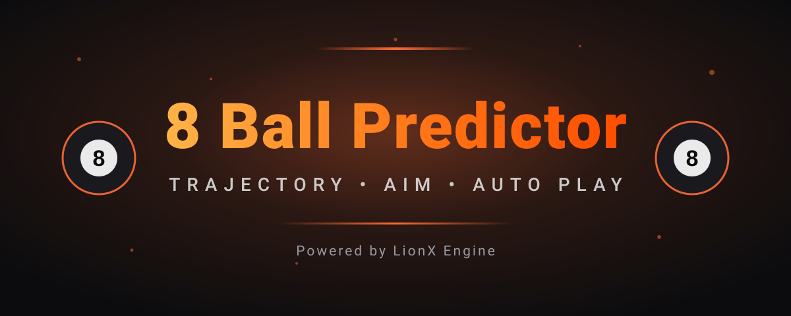

<div align="center">



# 8 Ball Pool Predictor

### Premium trajectory predictor & mod menu — by LionX Engine.

</div>

---

## Contents

- Features
- How It Works
- Building library.so
- Attaching to the Game
- Security
- Prediction System
- Menu Tabs
- Project Structure
- Tech Stack
- License Panel
- Support

---

##  Features

### Draw Settings (Prediction)

| Feature | Description |
|---|---|
| **Draw Lines** | Trajectory prediction line — exact ball path before every shot |
| **Draw Pockets** | Pocket indicators with visual highlight |
| **Show Ball Numbers** | Ball number displayed on every ball |
| **Bounce Sync** | Cushion bounce markers |
| **Line Extension** | Extended aim guideline for long shots |
| **After Shot** | Prediction line stays after the shot |

### Auto Play System

| Feature | Description |
|---|---|
| **Auto Play Mode** | Fully automatic gameplay |
| **Auto Aim** | Aim assist — sets cue to the best angle |
| **Auto Pocket** | Automatic pocket targeting |
| **Auto Spin** | Automatic spin control |
| **Cushion Shot** | Bank shots off the cushion |
| **Clean Table** | Systematic table clearing |

### Auto Queue

| Feature | Description |
|---|---|
| **Auto Queue** | Automatic matchmaking |

### Extra Settings

| Feature | Description |
|---|---|
| **Power Slider** | Fine shot-power control |
| **Button Clicker** | Automates repetitive taps |
| **Disable Ads** | Blocks in-game ads |
| **Disable Flicker** | Smooth overlay rendering |
| **FPS Counter** | Real-time FPS display |

---

##  How It Works

The project is a **native shared library** (`library.so`) that runs **inside the 8 Ball Pool game process**. Architecture overview:

```
┌─────────────────────────────────────────────────┐
│  8 Ball Pool APK (com.miniclip.eightballpool)   │
│                                                 │
│  ┌──────────────┐      ┌──────────────────────┐  │
│  │ Game Engine  │◄────►│    library.so        │  │
│  │ (libmain)    │ hooks│  ┌────────────────┐  │  │
│  └──────────────┘      │  │ Prediction     │  │  │
│                        │  │ engine         │  │  │
│                        │  ├────────────────┤  │  │
│                        │  │ ImGui menu     │  │  │
│                        │  │ (5 tabs)       │  │  │
│                        │  ├────────────────┤  │  │
│                        │  │ License check  │  │  │
│                        │  └────────────────┘  │  │
│                        └──────────────────────┘  │
└─────────────────────────────────────────────────┘
```

1. **Injection** — `library.so` is loaded into the game process at startup (see [Attaching to the Game](#attaching-to-the-game)).
2. **Hooks** — On load, `JNI_OnLoad` fires: it verifies the package name, then hooks key game functions (`setActiveVisualCue`, `StartMatch`) using And64InlineHook/Substrate.
3. **Prediction** — Every frame, the engine reads ball positions from game memory, calculates trajectories, collisions and bounces, then draws prediction lines through an ImGui overlay.
4. **Menu** — A floating ImGui menu (5 tabs) lets the user toggle every feature in real time.
5. **License** — A key-based license system validates the user before features unlock.

---

##  Building library.so

`library.so` is compiled from the C++ sources in `app/src/main/jni/` using the **Android NDK** (`ndk-build`).

### Requirements

- Android NDK r25 or newer (tested: r28, r29)
- Windows (`build.bat`) or any OS with `ndk-build` on PATH
- Target: `arm64-v8a`, platform `android-29`, C++20, release build

### Build configuration

| Setting | Value |
|---|---|
| Module name | `rary` → outputs `library.so` |
| ABI | `arm64-v8a` |
| STL | `c++_static` |
| Optimization | Release (`-O2`, stripped) |
| Visibility | Hidden (`-fvisibility=hidden`) |
| Static libs linked | libcurl, libssl, libcrypto |

Defined in `app/src/main/jni/Android.mk` and `Application.mk`.

### Build steps

**Option A — using build.bat (Windows):**

```bat
build.bat
```

This runs `ndk-build -C app\src\main -j8 -B`, then copies the output:

```
app\src\main\libs\arm64-v8a\library.so  →  .\library.so
```

**Option B — manual ndk-build:**

```bash
ndk-build -C app/src/main -j8 -B
# output: app/src/main/libs/arm64-v8a/library.so
```

**Option C — Android Studio:**

Open the project, sync Gradle, then `Build → Make Project`.
The APK build also compiles the native library via externalNativeBuild.

### Output

The compiled `library.so` (~6 MB, ARM64, stripped) is the injectable module.
It exports `JNI_OnLoad` as its entry point.

---

##  Attaching to the Game

`library.so` must be loaded **inside the 8 Ball Pool process** (`com.miniclip.eightballpool`).
The standard method is APK patching:

### Step 1 — Get the game APK

Download the 8 Ball Pool APK (matching the version the offsets were built for)
or pull it from a device:

```bash
adb pull /data/app/com.miniclip.eightballpool-*/base.apk
```

### Step 2 — Decompile

```bash
apktool d base.apk -o patched
```

### Step 3 — Add the library

Copy the built `library.so` into the APK's native lib folder:

```
patched/lib/arm64-v8a/library.so
```

### Step 4 — Add the loader

Patch the main activity's `onCreate` (smali) to load the library at startup:

```smali
const-string v0, "rary"
invoke-static {v0}, Ljava/lang/System;->loadLibrary(Ljava/lang/String;)V
```

(`rary` is the module name — Android resolves it to `library.so`.)

### Step 5 — Rebuild and sign

```bash
apktool b patched -o modded.apk
# sign with your own keystore:
apksigner sign --ks my-release-key.jks modded.apk
```

### Step 6 — Install

```bash
adb install modded.apk
```

### What happens at runtime

1. Game starts → `System.loadLibrary("rary")` loads `library.so`.
2. `JNI_OnLoad` runs: verifies the package is `com.miniclip.eightballpool`,
   checks for Xposed/root frameworks, and starts code-integrity protection.
3. Hooks are installed on game functions; the ImGui menu appears as a floating overlay.
4. The license screen prompts for a key before features activate.

> **Note:** The library refuses to run if injected into any other app —
> the package-name check is a built-in safety measure.

---

##  Security

Built-in protections in `library.so`:

| Protection | Description |
|---|---|
| **Package verification** | `JNI_OnLoad` checks the host package is `com.miniclip.eightballpool`; refuses to run elsewhere |
| **Xposed detection** | Detects Xposed/EdXposed frameworks at startup |
| **Code integrity** | Checksums the executable code segment via `/proc/self/maps` to detect tampering |
| **String obfuscation** | Sensitive strings encrypted with XOR (`oxorany`) |
| **Symbol hiding** | `-fvisibility=hidden` and `--strip-all` remove symbols from the binary |
| **License keys** | Time-based keys validated through the license panel backend |

---

##  Prediction System

1. **Ball Tracking** — cue ball and object ball positions read from game memory
2. **Trajectory Calculation** — path computed from the shot angle
3. **Collision Detection** — first contact point and post-bounce path predicted
4. **Pocket Analysis** — target pocket highlighted
5. **Visual Overlay** — smooth lines and markers drawn with ImGui

---

##  Menu Tabs

| Tab | Content |
|---|---|
| **Draw Settings** | Prediction lines, pockets, ball numbers, bounce markers |
| **Auto Play** | Auto play, auto aim, auto pocket, spin, cushion shots |
| **Auto Queue** | Matchmaking automation |
| **Extra Settings** | Power slider, clicker, ads off, FPS counter |
| **Info** | License status, expiry countdown, version |

The menu header shows a VIP license expiry countdown.

---

##  Project Structure

```
8ball-pool-predictor/
├── app/src/main/
│   ├── java/com/eightballpool/bp/   # App shell, floating button
│   ├── jni/                         # Native C++ (hooks, menu, prediction)
│   │   ├── main.cpp / menu.h / game.h
│   │   ├── mod/                     # PowerSlider, Clicker, keylogin
│   │   ├── game/inc/                # Prediction.fast.h, AutoPlay.impl.h
│   │   └── include/external/        # xhook, Substrate, imgui
│   └── res/
├── index.html / app.js / style.css  # License panel (web)
├── license_panel/                   # Firebase hosting panel
├── build.bat                        # NDK build script
└── LICENSE
```

---

##  Tech Stack

| Technology | Purpose |
|---|---|
| **Android (Java)** | App shell, floating overlay |
| **C++ (NDK)** | Hooks, prediction engine |
| **ImGui** | In-game menu UI |
| **And64InlineHook / Substrate / xhook** | Function hooking |
| **HTML / CSS / JS** | License panel |
| **Firebase** | License backend |

---

##  License Panel

| Feature | Description |
|---|---|
| **Key Generation** | Time-based license keys |
| **User Management** | Track users and keys |
| **Admin Dashboard** | Keys, expiry, logs in one place |
| **Firebase Backend** | Real-time sync |

```bash
python3 -m http.server 8000
# open http://localhost:8000
```

---

##  Support

- **Channel:** [LionX Engine](https://t.me/LionX_Engine)
- **Support:** [LionX Support](https://t.me/LionXsupport_bot)

---

<div align="center">

Built with passion by **LionX Engine**

</div>
